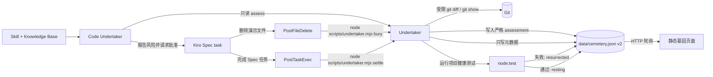

# 代码守灵堂设计

## 设计目标

用最少组件完成一个可审计的 Kiro 闭环：Code Undertaker Agent 先评估并请求精确授权、Agent 通过 Spec 删除演示文件、Hook 登记墓碑、任务后测试裁定状态、静态页面展示证据与结果。系统离线运行，不上传源码，不引入数据库或第三方运行时依赖。

## 非目标

- 不监听用户手工文件操作。
- 不分析函数级删除或任意语言 AST。
- 不宣称能分析任意代码库或提供通用多语言自动删除。
- 不自动删除、恢复或重写真实业务代码。
- 不把线上回放伪装成本地实时 Hook。
- 不提供账号、协作、云同步或源码存储。

## 架构



## 组件职责

### `.kiro/agents/code-undertaker.md`

仓库级 Kiro Custom Agent。它加载 Steering、Feature Spec、`code-undertaker` Skill 和 references Knowledge Base；先运行 assessment，报告受控事实并请求精确删除授权。它不得直接写墓园数据、健康测试或 Hook 配置，也不得执行危险 Git/删除命令。若当前 Kiro 无法搜索知识库，则直接读取同一组 Skill references，不复制第二套规则。

### `.kiro/skills/code-undertaker/references`

Agent Knowledge Base 的唯一领域与 Hook 契约来源。只描述确定性状态、隐私边界和降级方式；不保存用户代码或模型推理。

### `.kiro/hooks/*.json`

- `bury-on-delete.json` 只匹配 `demo-src` 下的 `.mjs` 文件，并调用确定性的 `bury` 命令。
- `settle-after-task.json` 在 Spec 任务完成后调用 `settle` 命令。
- Hook 只负责触发，不承载业务逻辑。

### `scripts/undertaker.mjs`

命令入口。`bury` 不插值也不持久化 Hook 载荷，而以受限 Git 删除记录作为可验证事实；`settle` 运行项目健康测试并写回当前墓碑状态。预期的测试失败属于领域结果，不应导致墓碑状态丢失。

### `scripts/cemetery.mjs`

纯领域逻辑，包括：路径过滤、墓碑创建、不可变 upsert、当前墓碑裁定和数据校验。该模块不负责页面渲染或 Hook 配置。

### `data/cemetery.json`

本地单一事实源。v2 增加一个严格、可为空的 `assessment`，页面阶段由 assessment 和墓碑状态共同推导。写入时使用临时文件后替换，避免留下半截 JSON。页面只读取该文件，不读取 Git 或 Hook 原始载荷。

### 静态页面与本地服务

浏览器通过本地 HTTP 服务读取墓园数据，并按状态渲染：`pending` 为等待裁定，`resurrected` 为幽灵诈尸，`resting` 为白花安息。线上构建使用同一页面和脱敏回放数据。

### `demo-src` 与健康测试

`active-consumer.mjs` 初始依赖 `legacy-ghost.mjs`。删除旧模块后，健康测试会因断裂引用失败，形成可预测的“诈尸”；Bugfix Spec 随后移除依赖但保持公开行为不变。

## 数据模型

```json
{
  "version": 2,
  "mode": "live",
  "activeId": "stable-grave-id",
  "updatedAt": "2026-10-12T00:00:00.000Z",
  "assessment": {
    "id": "stable-grave-id",
    "agentId": "code-undertaker",
    "targetPath": "demo-src/legacy-ghost.mjs",
    "assessedAt": "2026-10-12T00:00:00.000Z",
    "tracked": true,
    "workspaceClean": true,
    "baselinePassed": true,
    "dependentCount": 1,
    "risk": "high"
  },
  "graves": [
    {
      "id": "stable-grave-id",
      "fileName": "legacy-ghost.mjs",
      "filePath": "demo-src/legacy-ghost.mjs",
      "lineCount": 3,
      "ageDays": 665,
      "commitCount": 13,
      "deletedAt": "2026-10-12T00:00:00.000Z",
      "state": "resurrected",
      "cause": "死于重构",
      "test": {
        "passed": false,
        "failed": 1,
        "durationMs": 21
      }
    }
  ]
}
```

`assessment` 只能包含示例中的九个字段。`risk` 由事实唯一派生：任一安全前提失败为 `blocked`，否则有依赖为 `high`，无依赖为 `low`。`cause` 只能来自程序内置的受控枚举。禁止出现依赖路径、自由文本推理、`source`、源码片段、命令输出、环境变量、绝对用户路径或完整 Hook 载荷。

## 核心流程

### 评估与授权

1. 用户在 Kiro 选择 Code Undertaker，并提出退役固定演示模块。
2. Agent 运行固定目标命令 `npm run funeral:assess -- demo-src/legacy-ghost.mjs`；命令只检查 Git 跟踪、无关工作区改动、基线健康测试和 `demo-src` 内的直接依赖数量。
3. 命令将严格 assessment 写入 cemetery v2；页面显示风险证据，不显示源码、依赖路径或模型推理。
4. `blocked` 立即停止。`high` 或 `low` 均由 Agent 报告证据，并向用户请求精确目标授权。
5. 获得授权后，Agent 仅从 Kiro Spec 任务入口执行 `.kiro/specs/code-funeral-hall/tasks.md` 的任务 7.2，不在普通聊天中直接删除，也不把普通聊天修改包装成 `PostTaskExec` 证据。

### 删除与立碑

1. Kiro 根据已评估、已批准的未完成 Spec 任务删除 `demo-src/legacy-ghost.mjs`。
2. `PostFileDelete` 调用 `undertaker.mjs bury`。
3. 脚本从受限 Git diff 中确认删除路径，并从已提交版本读取仅用于统计的内容。
4. 脚本计算行数、年龄和提交次数，丢弃源码，只将墓碑元数据写入 JSON。
5. 页面轮询后显示 `pending` 墓碑。

### 诈尸与安息

1. 删除任务结束后，`PostTaskExec` 调用 `undertaker.mjs settle`。
2. 健康测试因断裂 import 失败，当前墓碑进入 `resurrected`。
3. 用户让 Kiro 为该回归创建 Bugfix Spec，并明确“不得恢复旧文件、公开行为不变”。
4. Kiro 修复消费者；Bugfix 任务结束后再次触发裁定。
5. 健康测试通过，当前墓碑进入 `resting`。

## 路径和命令安全

- 只接受规范化后位于 `demo-src/` 内的 `.mjs` 相对路径。
- 拒绝绝对路径、`..` 路径穿越和非删除状态。
- Git 与 Node 子进程使用可执行文件加参数数组，不将事件文本拼接成 Shell 命令。
- Hook 标准输入是非持久化的不可信输入；解析失败时使用空对象并依赖受限 Git diff。
- 任何删除都必须来自用户批准的 Spec 任务，脚本本身不删除文件。
- Agent 权限拒绝直接写 `data/cemetery.json`、健康测试和 Hook 配置；状态只能由受控命令产生。

## 故障处理与降级

- 没有匹配删除：`bury` 不写伪记录，给出可读提示后安全结束。
- Git 不可用或没有基线提交：停止葬礼登记并提示先建立基线。
- JSON 无效：拒绝覆盖原数据并报告错误。
- 页面无法读取 JSON：显示可理解的离线提示，而不是空白页面。
- `PostFileDelete` 在当前构建异常：文档允许将现有登记 Hook 临时改成 `Stop`，让同一个 `bury` 命令通过 `git diff` 找删除；不额外提交第三个 Hook，也不声称主触发器已验证。

## 测试策略

- 领域单元测试：安全路径过滤、元数据不含源码、不可变 upsert、状态转换。
- assessment 单元测试：v2 严格字段、风险派生、稳定 ID、隐私字段和重复评估。
- Agent 契约测试：工具、resources、Knowledge Base、安全权限和系统提示边界。
- 项目健康测试：修复前可预测失败，修复后保持 `memorialMessage` 的公开输出。
- 项目验证：JSON 解析、Hook v1 结构、静态构建产物和敏感字段扫描。
- 人工冒烟：Kiro Agent 删除文件后验证 `pending → resurrected → resting` 的完整视觉变化。

## 关键取舍

- 使用 Git diff 而不是只相信事件载荷：可审计，并可为触发器兼容问题兜底。
- 让 Kiro Agent 负责调查、授权交互与修复，让 Node 脚本负责确定性事实：既能展示 Agent，又不把模型推理当作数据源。
- Knowledge Base 复用 Skill references：避免两套安全规则失步；知识功能不可用时直接读取同一文件。
- 使用 JSON 而不是数据库：更少代码、便于静态演示、没有凭据风险。
- 首版只支持文件级删除：与 Kiro 原生 `PostFileDelete` 对齐；函数级 diff 留待后续。
- 现场与回放明确分开：本地展示真实 Hook，线上页面保证评委随时可访问。
