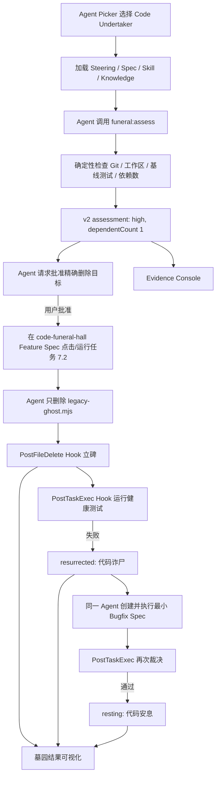

# 代码守灵堂：AI 接手与回家录屏说明

> 仓库：<https://github.com/xiaosongxiaosong1111/code-funeral-hall>
>
> 用途：让家中的 AI 在不了解历史聊天的情况下，安全接管项目并协助完成 Kiro 线上赛录屏。

## 0. 先理解这次升级

项目没有丢掉“代码守灵堂、诈尸、安息”的鬼点子，而是把它从纯视觉梗升级为 **Kiro 原生代码退役 Agent**：

- 产品仍叫 **代码守灵堂 / Code Funeral Hall**；
- Kiro Agent 叫 **Code Undertaker / 代码入殓师**；
- 页面是 Agent 的证据台；
- 墓碑、幽灵和白花是退役结果的可视化。

“鬼点子”不等于必须真的讲鬼。这里真正的巧思是工程语义映射：存活依赖叫“诈尸”，回归测试是“死亡证明”，验证通过才叫“安息”。趣味负责让人记住，Agent 和可审计证据负责让项目成立。

一句话定位：

> 别人让 AI 写代码，我们让 Agent 为删除代码负责：调查风险、请求批准、执行退役，并证明旧代码真的可以离开。

## 1. 接手后的第一原则

当前仓库应保持可重复录制的安全基线。在用户明确说“开始正式录制”以前：

- 不要运行 `npm run funeral:assess -- demo-src/legacy-ghost.mjs`；
- 不要删除 `demo-src/legacy-ghost.mjs`；
- 不要修改 `demo-src/active-consumer.mjs`；
- 不要手改 `data/cemetery.json` 制造 `live`、`high`、`resurrected` 或 `resting`；
- 不要勾选尚未真实执行的 Spec 任务；
- 不要运行 `git reset --hard`、`git clean` 或宽泛恢复命令；
- 不要把回放数据、页面上的 `agentId` 或动画冒充成 Kiro 运行证据。

`funeral:assess` 对源码是只读的，但会把脱敏评估写入 `data/cemetery.json`。因此正式录屏应在镜头中由选中的 Code Undertaker 调用它，而不是提前手工运行。

## 2. 可以直接发给家中 AI 的提示词

```text
请先完整阅读 docs/AI-HANDOFF.md，再做只读接管检查。

目标是协助我录制“代码守灵堂”的 Kiro Agent 演示。未经我明确说“开始正式录制”，不要运行 funeral:assess，不要删除 demo-src/legacy-ghost.mjs，不要修改 demo-src/active-consumer.mjs，不要手改 data/cemetery.json，也不要执行会丢失本地改动的 Git 命令。

先向我报告：
1. Git 工作区和分支状态；
2. npm test 与 npm run validate 的结果；
3. Kiro Agent Picker 是否能看到 Code Undertaker；
4. Feature Spec、Skill、Steering 和两个 Hooks 是否被当前 Kiro 识别；
5. Knowledge Base 在当前 IDE 中是“已验证可搜索”还是“尚未实机验证”；
6. 页面当前是 replay 还是 live；
7. 开始正式录制后的第一个动作。

只报告事实。确认准备无误后停下来，等我说“开始正式录制”。
```

如果接手者不是 Kiro，它可以检查文件、运行基线测试、启动网页和解释流程，但不能声称自己验证了 Kiro Agent Picker、Knowledge Base 或 Hooks。

## 3. Agent、工具和页面分别负责什么

本项目故意把“智能决策”和“确定性事实”分开：

| 层 | 职责 | 不能冒充什么 |
|---|---|---|
| Kiro `Code Undertaker` | 读取知识和 Spec、组织流程、请求授权、诊断失败、创建并执行最小 Bugfix | 不能捏造测试或 Git 事实 |
| `funeral:assess` | 确定性检查 Git、工作区、基线测试和依赖数量，生成 v2 assessment | 不是大模型，也不是自主 Agent |
| 两个 Hooks | 删除后立碑，任务后运行健康测试并裁决 | 不负责替用户批准删除 |
| Evidence Console | 展示 assessment 和阶段 | 页面标签不是执行证明 |
| 墓园视觉 | 把 `pending / resurrected / resting` 变成墓碑、幽灵和白花 | 动画不是测试结果 |

项目不接 OpenAI、通义、DeepSeek 等外部模型 API。Kiro 本身就是比赛要展示的 AI Agent；额外套一个聊天接口只会稀释重点。

## 4. 完整因果链



录像必须守住这条因果链。Kiro 思考和测试等待可以加速，但不要把不同克隆、不同录次的结果拼成一条假链。

## 5. 为什么评估结果必须是 high

受控演示基线中：

```text
demo-src/active-consumer.mjs → demo-src/legacy-ghost.mjs
```

`npm run funeral:assess -- demo-src/legacy-ghost.mjs` 应产生以下受控事实：

- `agentId`: `code-undertaker`；
- `targetPath`: `demo-src/legacy-ghost.mjs`；
- `tracked`: `true`；
- `workspaceClean`: `true`；
- `baselinePassed`: `true`；
- `dependentCount`: `1`；
- `risk`: `high`。

风险语义：

- `low`：前置检查通过且没有存活依赖；
- `high`：前置检查通过，但仍有存活依赖；
- `blocked`：未跟踪、工作区存在无关改动或基线测试失败等前置条件不满足。

评估只保存数量，不保存消费者路径、源码、命令原始输出或模型思维链。`high` 不是 Agent 随口判断，而是本地规则根据 `dependentCount` 生成的可复现结果。

## 6. 关键文件

| 路径 | 作用 | 录屏是否展示 |
|---|---|---|
| `.kiro/agents/code-undertaker.md` | Agent Picker 中的 Code Undertaker 配置与系统提示 | 是 |
| `.kiro/specs/code-funeral-hall/` | Feature Spec；删除必须从这里点击/运行任务 7.2 | 是 |
| `.kiro/steering/` | 产品、结构、技术和安全约束 | 快速展示 |
| `.kiro/skills/code-undertaker/` | 安全退役 Skill 与知识资料 | 是 |
| `.kiro/hooks/bury-on-delete.json` | `PostFileDelete` 后登记墓碑 | 是 |
| `.kiro/hooks/settle-after-task.json` | `PostTaskExec` 后运行健康测试并裁决 | 是 |
| `scripts/undertaker.mjs` | `assess / bury / settle` 编排 | 不必逐行讲 |
| `scripts/cemetery.mjs` | v2 数据校验、风险与状态领域逻辑 | 不必逐行讲 |
| `demo-src/legacy-ghost.mjs` | 唯一获准删除的受控目标 | 是 |
| `demo-src/active-consumer.mjs` | 存活依赖与后续最小修复目标 | 是 |
| `data/cemetery.json` | assessment 与墓碑的元数据-only 数据源 | 结尾展示 |
| `index.html / app.js / styles.css` | Evidence Console 和墓园 | 是 |
| `tests/project-health.test.mjs` | 决定诈尸或安息的健康测试 | 可展示断言 |
| `docs/KIRO-DEMO-GUIDE.md` | 实际操作、排错和回退 | 接手 AI 必读 |
| `docs/VIDEO-SCRIPT.md` | 3–5 分钟逐镜头脚本 | 正式录制照读 |

## 7. 只读接管检查

在项目根目录运行：

```powershell
node --version
git --version
git status --short
git branch --show-current
git log -1 --oneline
Test-Path .\demo-src\legacy-ghost.mjs
npm test
npm run validate
```

预期：

- Node.js 20 或更高；
- 分支为预期分支，Git 状态为空或只有用户明确知道的改动；
- 目标文件存在且已被 Git 跟踪；
- 全量测试通过；
- 项目契约校验通过；
- `data/cemetery.json` 仍为 `replay` 基线。

仓库的 `replay` 基线可以带一组用于预览版式的 high assessment 和诈尸墓碑；它只是示例，不代表本机已经运行过 Agent。正式的 `funeral:assess` 会开始新的 live 退役案并清除回放墓碑。

此时不要运行 `funeral:assess`。`npm run build` 会删除并重建被忽略的 `dist/`，也不属于只读接管检查；需要生成发布产物时再运行。

## 8. Kiro 实机检查

用 Kiro 打开包含 `.kiro` 的仓库根目录：

1. 在 Agent Picker/Agent 下拉框确认出现 **Code Undertaker**；
2. 选择它，而不是在聊天框输入 `/code-undertaker`；
3. 确认 Feature Spec、Skill、Steering 和两个独立 Hooks 可见；
4. 查看 Agent 资源是否加载；
5. 对 Knowledge Base 只报告当前机器的真实状态。

重要边界：

- `.kiro/agents/code-undertaker.md` 存在，只证明配置进入了仓库；
- `npm run validate` 通过，只证明本地契约通过；
- 页面出现 `agentId: code-undertaker`，只证明数据字段存在；
- **只有真实 Kiro 中选中 Agent、执行动作并触发 Hooks 的连续录屏，才是比赛证据。**

Knowledge Base 的本机 IDE 搜索能力可能随 Kiro 版本而异。未实际搜索成功时，必须写“尚未实机验证”，不能说“已加载并使用”。

## 9. 在家准备正式录制

推荐使用全新克隆作为一次性录制副本：

```powershell
git clone https://github.com/xiaosongxiaosong1111/code-funeral-hall.git
cd code-funeral-hall
npm test
npm run validate
npm run dev
```

然后：

1. 浏览器打开终端显示的本地 HTTP 地址；不要直接双击 HTML；
2. Kiro 打开同一个根目录；
3. 选择 Code Undertaker；
4. 屏幕同时准备好 Kiro、浏览器和本地服务终端；
5. 保留初始 `replay` 示例画面，把真实 assessment 放到正式录制中执行；
6. 使用 1920×1080，并确认 Evidence Console、风险和墓碑状态可读。

若默认端口被占用：

```powershell
$env:PORT = 4174
npm run dev
```

## 10. 正式录制第一阶段：Agent 尸检

先在镜头中选择 Code Undertaker，然后对它说：

```text
请读取当前 Feature Spec、Steering 和 code-undertaker Skill。现在只做退役前尸检，不删除也不修改源码。请调用：
npm run funeral:assess -- demo-src/legacy-ghost.mjs
根据工具返回的受控事实说明风险，并在任何删除前停下来请求我批准精确目标。
```

必须拍到：

- Agent Picker 中选中的 Code Undertaker；
- assessment 命令确实由该会话调用；
- Evidence Console 显示 Git、基线、依赖数 `1` 和 `high`；
- Agent 明确等待用户批准；
- 目标文件此时仍存在。

这一步后页面进入 `live`，但还没有墓碑，因此标签应是“**Kiro Agent · 现场评估**”；删除立碑后才变为“**Kiro Hook · 实时**”。任何 `live` 标签单独都不证明 Kiro，证据来自同一镜头中的 Agent 调用和 Hook 输出。

## 11. 第二阶段：从 Feature Spec 运行任务 7.2，让它诈尸

确认 assessment 为 `high` 后，先对同一个 Agent 明确授权：

```text
我批准退役的精确目标仅为 demo-src/legacy-ghost.mjs。不要通过普通聊天直接删除；接下来只允许由 code-funeral-hall Feature Spec 的任务 7.2 执行。本任务只删除旧模块，不要修改 demo-src/active-consumer.mjs，不要提前修复测试，也不要直接修改 data/cemetery.json。
```

随后打开 Kiro 的 `code-funeral-hall` Feature Spec，在任务列表中**点击/运行任务 7.2**。聊天授权不能代替这个操作；视频必须拍到任务 7.2 被启动，才能把后续 `PostTaskExec` 与这次删除关联起来。

任务 7.2 执行时，burial 允许的唯一 Spec 元数据文件变化是 `.kiro/specs/code-funeral-hall/tasks.md` 中由真实执行产生的任务状态。不得修改 `requirements.md`、`design.md` 或其他任务内容，也不得手工勾选任务伪造完成。

授权前核对：

- 唯一删除目标正确；
- Agent 已看到一个存活依赖；
- 用户做出了明确批准；
- Kiro 界面显示正在执行 `code-funeral-hall` 任务 7.2，而不是普通聊天自由删除；
- 当前任务不会顺便修复消费者；
- Spec 侧只有真实任务状态文件允许变化。

预期链路：

1. Kiro 从 Feature Spec 启动任务 7.2，Agent 只删除目标；
2. `PostFileDelete` 调用 `bury`，assessment 与墓碑使用同一个稳定 ID；
3. 墓碑进入 `pending`；
4. Spec 任务完成后，`PostTaskExec` 调用 `settle`；
5. 健康测试因旧 import 失败；
6. 同一墓碑进入 `resurrected`，页面显示红色幽灵。

必须让“测试失败 · 已诈尸”停留几秒。不要立即掩盖失败，它正是 Agent 下一步诊断的真实输入。

## 12. 第三阶段：同一 Agent 最小修复

继续使用已经选中的 Code Undertaker：

```text
刚才的退役导致健康测试失败。请基于真实失败创建并执行最小 Bugfix Spec：不得恢复 demo-src/legacy-ghost.mjs；不得改变 memorialMessage('旧接口') 返回 '旧接口 已归档' 的公开行为；不得修改健康测试或墓园 JSON 伪造通过。只修复仍依赖旧模块的消费者，并让 PostTaskExec 重新裁决。
```

接手 AI 必须检查：

- 没有恢复旧文件；
- 业务代码只做行为保持的最小修复；
- 没有降低或删除测试；
- 没有直接写 `resting`；
- Bugfix Spec 清楚写出当前行为、预期行为和保持不变行为；
- Hook 重新运行健康测试；
- 同一墓碑变为 `resting`，没有创建重复墓碑。

## 13. 录制结束后的验证

```powershell
npm test
npm run validate
npm run build
git status --short
git diff --stat
```

`npm run build` 会生成公开 `dist/`，并强制发布数据为 `replay`；它不应把线上静态页伪装成 Kiro 实时现场。

检查 `data/cemetery.json` 不包含：

- 源码或自由文本推理；
- 依赖文件路径清单；
- Hook 原始输入或完整命令输出；
- `C:\Users\...` 等用户绝对路径；
- Token、Cookie、邮箱、环境变量或凭据。

## 14. 页面阶段与下一步动作

| 数据状态 | 页面含义 | 下一步 |
|---|---|---|
| 无 assessment | 等待 Agent 尸检 | 选择 Agent 并运行 assess |
| assessment，无墓碑 | 风险已评估，等待批准 | 用户核对后批准精确目标 |
| `pending` | 删除已登记，等待 Hook 裁决 | 不要手工改数据 |
| `resurrected` | 测试失败，代码诈尸 | 同一 Agent 创建 Bugfix Spec |
| `resting` | 修复通过，安全安息 | 运行最终验收并收尾 |

网页是 Agent Evidence Console + 墓园结果层，不是独立聊天机器人。

## 15. 故障、回退和重录

### Agent Picker 看不到 Code Undertaker

- 确认 Kiro 打开的是仓库根目录；
- 确认 `.kiro/agents/code-undertaker.md` 存在；
- 重载工作区并查看 Kiro 的配置错误；
- 若仍不可见，停止正式录制，记录当前 Kiro 版本并排查；
- 不要改用 `/code-undertaker` 后声称它是 Custom Agent。

### Knowledge Base 没有搜索结果

先确认当前 Kiro 版本是否支持对应资源。可以让 Agent 直接读取 Skill/reference 文件继续排障，但视频和说明必须如实写“Knowledge Base 未完成实机验证”，不能伪造语义检索成功。

### assessment 不是 high

- `blocked`：按输出检查 Git 跟踪、无关工作区改动和基线测试；不要绕过；
- `low`：确认消费者是否仍导入目标；若演示基线已被改动，换一个干净克隆；
- 不要手改 `dependentCount` 或 `risk`。

### `PostFileDelete` 没触发

依次确认删除者、工作区根目录、Hook 启用状态、匹配路径和 Git 基线。最后才允许使用文档约定的 **Stop + Git diff fallback**，并在录像和提交说明中明确标注 fallback；不得声称 `PostFileDelete` 成功。

### 第一次任务被一次性修好

不要制造假失败。停止本次录制，使用新克隆重来，并再次强调“只删除，不修改消费者”。

### 需要重录

最安全的方式是新克隆或新 Git 工作树。先列出要保留的变化；不要对含未知改动的目录运行 `git reset --hard` 或 `git clean`。

## 16. 安全和诚实边界

- 只有用户明确批准后才允许删除精确目标；
- 当前目标严格限定为 `demo-src/legacy-ghost.mjs`；
- 脚本拒绝绝对路径、路径逃逸和非批准目标；
- 不保存源码、依赖路径清单或模型思维链；
- 不需要数据库、云服务或外部 API Key；
- 不宣称通用多语言依赖分析；
- 不宣称生产环境无人值守自动删除；
- 不把 `agentId`、页面动画或 `live` 标签当作 Kiro 证明；
- 不把 Knowledge Base 配置存在写成“本机已经检索成功”；
- 线上页面只能提供回放，真实证据来自 Kiro 连续录屏。

## 17. 比赛提交口径与 200 字说明

按本次线上赛页面口径：可提交可运行 Demo 或 3–5 分钟录屏，附 200 字内说明；评审为脑洞 35%、Kiro 使用深度 35%、交付完成度 30%。录屏要同时回答三件事：创意为什么好记、Kiro 为什么不可替代、作品是否真的跑通。

可直接提交的 200 字内中文说明：

> 代码守灵堂是一名可在 Kiro Agent Picker 选择的代码退役 Agent。它先对源码做只读尸检，核对 Git、依赖与测试，等待批准后通过 Spec 任务 7.2 删除旧模块；Hooks 自动立碑并裁定，失败则“诈尸”，Agent 以 Bugfix Spec 最小修复，测试通过才“安息”。网页只展示可审计证据，不伪造 AI 结果。

## 18. 3–5 分钟最简顺序

1. 页面用 20 秒解释“删除不等于安全”；
2. Kiro 选择 Code Undertaker，展示资源和两个 Hooks；
3. Agent 调用 assess，证据台显示 1 个依赖与 `high`；
4. Agent 请求批准，用户只批准目标文件；
5. 在 `code-funeral-hall` Feature Spec 点击/运行任务 7.2，Hooks 使墓碑诈尸；
6. 同一 Agent 创建 Bugfix Spec 并最小修复；
7. Hook 重验，同一墓碑安息；
8. 展示元数据-only JSON 和最终校验。

详细台词见 `docs/VIDEO-SCRIPT.md`。

## 19. 完成标准

只有同时满足以下条件，接手 AI 才能说“可以提交”：

- Kiro Agent Picker 真实选中了 Code Undertaker；
- assessment 由该 Agent 会话调用并产生 `high`；
- Agent 在删除前等待并获得用户对精确目标的批准；
- 视频拍到用户在 `code-funeral-hall` Feature Spec 点击/运行任务 7.2，而非普通聊天直接删除；
- 任务 7.2 只删除唯一目标，Spec 侧只产生真实的 `tasks.md` 状态变化；
- 两个 Hooks 的真实执行在连续录屏中可见；
- 视频拍到同一退役案从 `high` 到 `resurrected` 再到 `resting`；
- 同一 Agent 创建并执行最小 Bugfix Spec，未恢复旧文件；
- 最终测试、validate 和 build 通过；
- 公开数据没有源码、思维链、绝对路径或凭据；
- 线上静态页明确标记为 replay；
- 视频控制在 3–5 分钟；
- Knowledge Base 和 fallback 的描述与本机真实情况一致。

## 20. 接手 AI 最后汇报模板

```text
当前阶段：准备 / 已尸检待批准 / 已删除待裁决 / 已诈尸待修复 / 已安息 / 被阻塞
Git 状态：
Kiro Agent Picker：Code Undertaker [已选中 / 未识别 / 未验证]
Knowledge Base：[实机可搜索 / 未实机验证 / 不可用，使用直接文件读取]
assessment：tracked [ ]，workspaceClean [ ]，baselinePassed [ ]，dependentCount [ ]，risk [ ]
Hooks：PostFileDelete [成功 / 未验证 / fallback]，PostTaskExec [成功 / 未验证]
页面模式：replay / live
墓碑状态：无 / pending / resurrected / resting
自动验证：test [ ]，validate [ ]，build [ ]
下一步唯一动作：
风险或需用户确认：
```

只填可证明的事实；不要把“配置写好了”填写成“运行时验证成功”。
