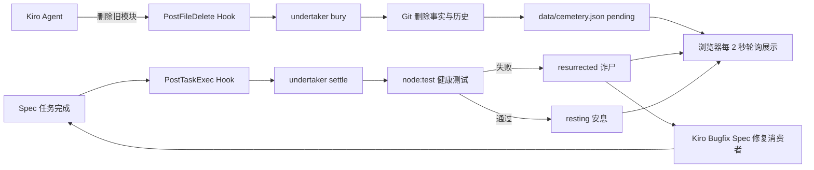

# 代码守灵堂：AI 接手与回家录屏交接说明

> 仓库：<https://github.com/xiaosongxiaosong1111/code-funeral-hall>
>
> 面向对象：接手本项目、帮助用户在家完成 Kiro 现场演示和 3–5 分钟参赛录屏的 AI。

## 0. 接手后的第一原则

当前仓库保存的是**可重复录制的安全基线**。在用户明确说“开始正式录制”以前：

- 不要删除 `demo-src/legacy-ghost.mjs`；
- 不要修改 `demo-src/active-consumer.mjs`；
- 不要手工把 `data/cemetery.json` 改成 `live`、`resting` 或伪造测试结果；
- 不要勾选 `.kiro/specs/code-funeral-hall/tasks.md` 中尚未真实执行的任务；
- 不要运行 `git reset --hard`、`git clean` 或宽泛恢复命令；
- 不要把浏览器“本地回放”冒充成 Kiro Hook 现场证据。

如果接手者不是 Kiro，可以帮助检查、解释、启动页面和排障，但正式视频中的删除和修复必须由 **Kiro Agent** 在同一工作区真实执行。

## 1. 可以直接发给接手 AI 的提示词

```text
请先完整阅读 docs/AI-HANDOFF.md，并按其中的“只读接管检查”执行。

当前目标是帮助我完成“代码守灵堂”的 3–5 分钟参赛录屏。未经我明确说“开始正式录制”，不要删除 demo-src/legacy-ghost.mjs，不要修改 demo-src/active-consumer.mjs，不要伪造 data/cemetery.json，也不要执行任何会丢失本地改动的 Git 命令。

先告诉我：
1. 当前 Git 状态是否干净；
2. 基线测试和项目校验是否通过；
3. Kiro 是否识别到 Feature Spec、Workspace Skill 和两个 Hooks；
4. 页面当前是“回放数据”还是“Kiro Hook 实时”；
5. 正式录制的下一步唯一动作是什么。

确认准备无误后停下来，等我说“开始正式录制”。
```

## 2. 一句话说明项目

“代码守灵堂”把一次不可见的代码删除变成可解释、可验证的数字葬礼：Kiro 删除旧模块后，Hooks 自动立碑并运行健康测试；测试失败，旧代码“诈尸”；Kiro 修复残留依赖且测试通过后，同一块墓碑才真正“安息”。

项目的核心结论是：

> 删除文件不是重构完成，测试通过才是安全删除的证据。

## 3. 它不只是一个前端页面

网页只是最终的可视化层。真实闭环包含：

1. **Feature Spec**：定义需求、设计、约束和可执行任务。
2. **Steering**：持续约束产品叙事、目录结构、技术栈、隐私和删除边界。
3. **Workspace Skill**：指导 Kiro 安全删除、识别“诈尸”并创建 Bugfix Spec。
4. **PostFileDelete Hook**：在 Kiro 删除受控演示文件后运行 `bury`，登记墓碑。
5. **PostTaskExec Hook**：任务结束后运行 `settle`，用健康测试裁定状态。
6. **Git**：提供可审计的删除事实和历史元数据。
7. **Node.js 领域逻辑**：过滤路径、生成墓碑、运行测试并原子写入 JSON。
8. **静态页面**：轮询 `data/cemetery.json`，把状态变成墓碑、幽灵和白花。



## 4. 真实演示故事

录制前，`demo-src/active-consumer.mjs` 仍然导入 `demo-src/legacy-ghost.mjs`：

```text
active-consumer.mjs → legacy-ghost.mjs
```

完整故事必须保持以下因果顺序：

```text
Kiro 只删除 legacy-ghost.mjs
  → PostFileDelete 识别 Git 删除并立碑
  → 墓碑进入 pending
  → PostTaskExec 运行健康测试
  → active-consumer 的旧 import 导致测试失败
  → 墓碑进入 resurrected，页面显示红色幽灵
  → Kiro 创建并执行最小 Bugfix Spec
  → 不恢复旧文件，只修复 active-consumer
  → 公开行为仍为 memorialMessage('旧接口') === '旧接口 已归档'
  → 健康测试通过
  → 同一块墓碑进入 resting，页面显示白花
```

第一次任务**必须只删除、不修复**。如果 Kiro 在第一次任务里同时修改消费者，受控失败就不会发生，视频也失去最重要的“诈尸”证据。

## 5. 当前仓库基线

接手时应看到：

- 分支：`main`；
- `demo-src/legacy-ghost.mjs` 存在且已被 Git 跟踪；
- `demo-src/active-consumer.mjs` 仍导入旧模块；
- `data/cemetery.json` 是 `mode: "replay"` 的脱敏示例数据；
- Spec 任务 1–5 已完成，任务 6–9 留给真实 Kiro 录制；
- 页面右上角初始显示“回放数据 · 非实时”；
- 导演台提示“当前是回放数据，还不是比赛证据”；
- 基线共有 16 项自动化测试；编写本交接文档时的验证结果是 16/16 通过。覆盖率命令只统计被 Node 测试进程采集到的模块，并非浏览器代码在内的全仓覆盖率。
- 回放数据里的“666 天、13 次提交”是为了展示版式的示例值，不代表本仓库已经产生过这次真实事件。

这些是准备状态，不代表真实 Hook 已经在用户家中的 Kiro 环境执行成功。

## 6. 关键目录和文件

| 路径 | 职责 | 录屏时是否展示 |
|---|---|---|
| `.kiro/specs/code-funeral-hall/` | Feature Spec 的需求、设计和任务 | 是，快速展示 |
| `.kiro/steering/` | 始终生效的产品、技术、结构、安全约束 | 可一带而过 |
| `.kiro/skills/code-undertaker/SKILL.md` | 安全葬礼与 Bugfix 工作流 | 是 |
| `.kiro/hooks/bury-on-delete.json` | `PostFileDelete` 触发立碑 | 是 |
| `.kiro/hooks/settle-after-task.json` | `PostTaskExec` 触发健康测试裁定 | 是 |
| `demo-src/legacy-ghost.mjs` | 唯一允许 Kiro 删除的演示旧模块 | 是 |
| `demo-src/active-consumer.mjs` | 删除后故意断裂、随后被最小修复的消费者 | 是 |
| `scripts/cemetery.mjs` | 路径过滤、墓碑模型、状态转换和数据校验 | 不必逐行展示 |
| `scripts/undertaker.mjs` | `bury` / `settle` 命令、Git 与测试编排 | 可简要展示 |
| `data/cemetery.json` | 页面唯一运行数据源，只允许公开元数据 | 结尾展示 |
| `demo-director.mjs` | 根据实时状态告诉录屏者下一步唯一动作 | 不必展示源码 |
| `index.html` / `app.js` / `styles.css` | 墓园视觉和自动轮询页面 | 是，作为主要画面 |
| `tests/project-health.test.mjs` | 决定诈尸或安息的健康测试 | 可展示断言 |
| `tests/fixtures/demo-src/` | 集成测试自带的稳定夹具，保证真实删除后全量测试仍可运行 | 不必展示 |
| `docs/KIRO-DEMO-GUIDE.md` | 完整现场操作和排障指南 | 接手 AI 必读 |
| `docs/VIDEO-SCRIPT.md` | 4 分钟逐镜头台词 | 正式录制照读 |

## 7. 状态机与导演台

墓碑只有三个业务状态：

| 状态 | 技术含义 | 页面表现 | 下一步 |
|---|---|---|---|
| `pending` | Kiro 删除已被登记，尚未附加测试结论 | 等待 Hook 验证 | 不操作，等待测试 |
| `resurrected` | 健康测试失败，仍有残留依赖 | 红色幽灵、“测试失败 · 已诈尸” | 记录证据，再让 Kiro 修复 |
| `resting` | 健康测试通过 | 白花、“测试通过 · 已安息” | 演示完成 |

显示模式与业务状态是两件事：

- `replay`：仓库自带或公开构建的回放数据，不是现场证据；
- `live`：本地 Undertaker 的 `bury` 命令写入的数据模式，但单凭此标签不能证明命令来自 Kiro Hook；
- “播放本地回放”：仅在浏览器中演示动画，不写数据，也不能作为参赛证据。

手工执行 `npm run funeral:bury` 也可能生成 `live` 数据。正式证据必须在连续录屏中同时出现 Kiro Agent 删除、Hook 执行和页面变化。

导演台会根据模式和状态自动改变：

```text
回放数据 → 复制真实删除指令
live 且无墓碑 → 去 Kiro 删除演示模块
pending → 等待测试，不显示按钮
resurrected → 复制修复指令
resting → 演示完成
```

## 8. 只读接管检查

在项目根目录运行：

```powershell
node --version
git --version
git status --short
git branch --show-current
git log -1 --oneline
Test-Path .\demo-src\legacy-ghost.mjs
npm test
npm run validate
```

预期结果：

- Node.js 为 20 或更高版本；
- Git 状态为空，或只有用户明确知道的文档/环境改动；
- `Test-Path` 返回 `True`；
- 16 项测试通过；
- `Project contracts are valid.`。

项目没有第三方运行时依赖，通常**不需要**执行 `npm install`。如果任何基线检查失败，先报告具体错误，不要直接改测试或清理 Git 工作区。

`npm run build` 会删除并重建被 Git 忽略的 `dist/`，因此它属于发布产物生成，不属于只读接管检查。需要检查发布产物时再单独运行。

`enabled: true` 和 `npm run validate` 只能证明 Hook 配置文件的基本结构有效，不能证明当前 Kiro 版本已经识别或触发它们。非 Kiro 接手 AI 应将运行时状态标为“未验证”，由用户在 Kiro 面板确认。

## 9. 在家准备录制

推荐使用全新克隆作为一次性录制副本：

```powershell
git clone https://github.com/xiaosongxiaosong1111/code-funeral-hall.git
cd code-funeral-hall
npm test
npm run validate
npm run dev
```

终端应显示：

```text
Code Funeral Hall: http://127.0.0.1:4173
```

然后：

1. 浏览器打开 <http://127.0.0.1:4173>，不要直接双击 `index.html`；
2. Kiro 选择 **File → Open Folder**，打开同一个项目根目录；
3. 确认 Kiro 能看到 Feature Spec、`code-undertaker` Skill 和两个启用的 Hooks；
4. 建议录制 1920×1080，浏览器缩放 110%–125%；
5. 正式录制时打开 `docs/VIDEO-SCRIPT.md`，按时间表照读；
6. 保持本地服务终端运行，页面会每 2 秒读取一次墓园数据。

如果 4173 端口被占用，可以在 PowerShell 临时使用另一个端口：

```powershell
$env:PORT = 4174
npm run dev
```

页面地址随之改为 `http://127.0.0.1:4174`。

## 10. 正式录制：第一阶段只删除

先在视频中快速展示 Spec、Skill 和两个 Hooks。随后使用页面按钮复制指令，或把下面的文字粘贴到 Kiro：

```text
/code-undertaker 请使用 #spec:code-funeral-hall 执行任务 6.1。先检查调用者和 Git 状态，只删除 demo-src/legacy-ghost.mjs；不要修改 active-consumer.mjs，也不要提前修复测试。
```

在批准操作前必须核对：

- 删除目标只有 `demo-src/legacy-ghost.mjs`；
- Kiro 已检查调用者和 Git 状态；
- 本任务没有修改 `active-consumer.mjs`；
- 删除来自 Kiro Agent，不是资源管理器、编辑器或终端手工删除。

预期自动链路：

1. `PostFileDelete` 调用 `node scripts/undertaker.mjs bury`；
2. 受限 Git diff 确认删除事实；
3. `data/cemetery.json` 切换为 `live` 并写入元数据-only 墓碑；
4. `PostTaskExec` 调用 `node scripts/undertaker.mjs settle`；
5. 健康测试因旧 import 失败；
6. 墓碑进入 `resurrected`。

`pending` 可能因为两个 Hook 紧接执行而只出现很短时间。视频不必强求拍到中间帧，但必须拍到：

- 右上角“Kiro Hook · 实时”；
- `legacy-ghost.mjs` 文件名；
- “测试失败 · 已诈尸”；
- 失败测试摘要和红色幽灵。

## 11. 正式录制：第二阶段修复

先让诈尸画面停留几秒，再把下面的文字交给 Kiro：

```text
删除 demo-src/legacy-ghost.mjs 后，demo-src/active-consumer.mjs 仍导入该模块，导致项目健康测试失败。预期 memorialMessage('旧接口') 仍返回 '旧接口 已归档'。不得恢复 legacy-ghost.mjs，不得改变该公开行为，也不得修改墓园 JSON 来伪造通过。请生成并执行最小 Bugfix Spec。
```

接手 AI 必须检查 Bugfix 是否满足：

- 没有恢复 `legacy-ghost.mjs`；
- 业务代码只对消费者做最小修改；新增 Bugfix Spec 文件和 Hook 更新墓园 JSON 属于预期变化；
- 没有修改健康测试来降低标准；
- 没有直接修改墓园状态伪造通过；
- `memorialMessage('旧接口')` 仍返回 `旧接口 已归档`；
- Bugfix 任务结束后由 `PostTaskExec` 再次运行裁定；
- 同一块墓碑转为 `resting`，没有生成第二块重复墓碑。

最终画面必须拍到：

- “测试通过 · 已安息”；
- 白花；
- 同一个文件和同一块墓碑；
- 测试耗时；
- `legacy-ghost.mjs` 仍然不存在。

## 12. 录制结束后的验证

在不打断录屏叙事的位置运行：

```powershell
npm test
npm run validate
npm run build
git status --short
git diff --stat
```

其中 `npm run build` 会重建 `dist/` 并把发布快照强制设为 `replay`；`dist/` 已被 Git 忽略，不会覆盖现场墓园源数据。

还要检查 `data/cemetery.json` 只包含：

- 稳定 ID；
- 仓库相对路径和文件名；
- 行数、Git 年龄、提交次数；
- 删除和更新时间；
- 固定死因；
- 状态；
- 测试是否通过、失败数和耗时。

出现以下任意内容应停止发布：源码片段、Hook 原始输入、`C:\Users\...` 绝对路径、Token、Cookie、邮箱、环境变量或 Git 凭据。

## 13. 常见故障与正确处理

### 页面没有打开

- 必须先运行 `npm run dev`；
- 使用终端输出的 HTTP 地址；
- 不要直接双击 HTML；
- 检查端口是否被其他进程占用。

### 页面一直显示“回放数据 · 非实时”

依次确认：

1. 删除确实由 Kiro Agent 完成；
2. Kiro 打开的是包含 `.kiro` 的仓库根目录；
3. `bury-on-delete.json` 已启用且无配置错误；
4. 删除路径确实是 `demo-src/legacy-ghost.mjs`；
5. 文件删除前已被 Git 跟踪；
6. `data/cemetery.json` 是否被 Hook 更新。

不要为了让页面变绿而手改 JSON。

### `PostFileDelete` 在当前 Kiro 版本中没有触发

完成上述检查后，唯一允许的兼容降级是：

- 临时把**现有** burial Hook 的触发器改成 `Stop`；
- 删除该 Hook 的文件 matcher；
- 命令仍保持 `node scripts/undertaker.mjs bury`；
- 不新增第三个 Hook；
- 视频和说明中明确称为 **Stop + Git diff fallback**；
- 不得声称 `PostFileDelete` 已成功。

### 第一次健康测试失败

这是预期剧情，不是需要立即掩盖的错误。先录下 `resurrected` 证据，再创建 Bugfix Spec。

### 第一次任务被 Kiro 一次性修好了

不要伪造失败。最稳妥的做法是停止本次录制，使用新的干净克隆重来，并再次强调“只删除，不修改消费者”。

### 需要重录

使用新的克隆或明确的 Git 工作树。不要在有未知改动的目录中运行宽泛恢复命令。接手 AI 应先列出具体变更并征得用户同意。

## 14. 安全边界

- Undertaker 脚本本身不会主动删除或恢复源码；删除必须来自用户批准的 Kiro Spec 任务。
- 只接受 `demo-src/` 下的 `.mjs` 仓库相对路径。
- 拒绝绝对路径、`..` 路径逃逸和非删除状态。
- Git 和 Node 子进程使用程序名加参数数组，不把不可信文本拼成 Shell 命令。
- Hook 标准输入不被原样保存或显示。
- JSON 使用临时文件后原子替换，避免半截数据。
- 本项目不需要数据库、云服务、API Key 或付费接口。
- 公开构建会强制把墓园数据标为 `replay`，避免把静态页面冒充实时 Hook。

## 15. 项目的诚实边界

不要把原型夸大成生产级代码治理平台：

- 当前只演示一个受控 `.mjs` 文件的删除；
- 当前健康裁定只运行 `tests/project-health.test.mjs`；
- JSON 是本地单文件状态，不支持多人并发；
- Hook 是删除后的验证，不会阻止删除、自动回滚或自动修复；
- 线上页面只能提供回放，真实 Kiro 证据来自本地连续录屏；
- 项目当前价值是“可运行、可审计的 Kiro 原生演示原型”，不是通用商业产品。

这不会削弱参赛价值。它的亮点是创意清晰、Kiro 使用深、因果链完整，而且每个状态都有真实测试证据。

## 16. 4 分钟视频的最简导演顺序

详细台词见 `docs/VIDEO-SCRIPT.md`。接手 AI 只需守住这七段：

1. **0:00–0:25**：网页讲问题——删除不等于安全；
2. **0:25–0:55**：Kiro 展示 Spec、Skill、两个 Hooks；
3. **0:55–1:30**：Kiro 只删除旧模块；
4. **1:30–2:10**：网页展示实时模式、测试失败和诈尸；
5. **2:10–3:05**：Kiro 展示 Bugfix Spec 的三项约束和最小修改；
6. **3:05–3:40**：网页展示测试通过和安息；
7. **3:40–4:05**：展示元数据-only JSON 并回到网页收尾。

Kiro 思考和命令等待可以剪短，但不能剪断：

```text
删除 → Hook → 测试失败 → Bugfix → 测试通过
```

## 17. 完成标准

只有同时满足下列条件，接手 AI 才能告诉用户“可以提交”：

- Kiro Agent 真实删除了唯一目标文件；
- 视频拍到 Feature Spec、Skill 和两个 Hooks；
- 页面明确进入“Kiro Hook · 实时”；
- 视频拍到同一次删除导致的测试失败和 `resurrected`；
- Kiro 通过 Bugfix Spec 修复消费者，未恢复旧模块；
- 同一块墓碑最终进入 `resting`；
- `npm test`、`npm run validate`、`npm run build` 通过；
- 公开数据不包含源码、凭据或用户绝对路径；
- 线上静态页面仍明确标注为回放；
- 视频时长控制在 3–5 分钟，因果关系看得懂。

## 18. 接手 AI 的最后汇报模板

```text
当前阶段：准备 / 已删除待裁定 / 已诈尸待修复 / 已安息 / 被阻塞
Git 状态：
Kiro 证据：Spec [有/无]，Skill [有/无]，PostFileDelete [成功/未验证/使用 fallback]，PostTaskExec [成功/未验证]
页面模式：回放 / 实时
当前墓碑状态：无 / pending / resurrected / resting
自动验证：npm test [结果]，validate [结果]，build [结果]
下一步唯一动作：
风险或需要用户确认的事项：
```

接手 AI 应以事实填写，不要用页面动画代替 Hook 证据，也不要把未执行的步骤写成已完成。
